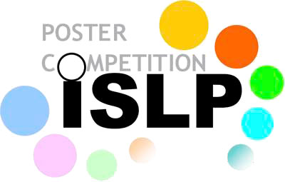

::: {.grid}
::: {.g-col-12 .g-col-md-3}
{width=100% style="border-radius:50%" fig-alt="Foto de Alvaro Chirino"}
:::
::: {.g-col-12 .g-col-md-9}
Estadístico con más de 15 años de experiencia en diseño muestral, encuestas de hogares, evaluación de impacto y medición de pobreza en Bolivia. Investigador Senior de [Fundación Aru](https://www.aru.org.bo), docente universitario de pregrado y postgrado, y facilitador de cursos nacionales e internacionales en inferencia causal, estrategias de muestreo y programación estadística. Coordinador Nacional del [International Statistical Literacy Project (ISLP-IASE)](https://islp-bolivia.github.io/).

[ Ver CV](cv.qmd){.btn .btn-primary .btn-sm}
:::
:::

## Formación

- **En curso** — Doctorado en Gestión del Desarrollo y Políticas Públicas, Universidad Mayor de San Andrés
- **2021** — Maestría en Modelaje Matemático, Universidad Mayor de San Andrés. Tesis: *Un indicador dinámico basado en componentes principales como alternativa al índice de necesidades básicas insatisfechas en los censos. Caso de estudio: Bolivia*
- **2011 – 2016** — Diplomados en Análisis Matemático de Datos, Fundamentos de Modelaje Matemático (UMSA), Evaluación de Políticas Sociales (UCB) y Educación Superior (UMSA)
- **2011** — Licenciatura en Estadística, Universidad Mayor de San Andrés

## Experiencia profesional

- **2025 – actual** — Investigador Senior, Fundación Aru
- **2021 – 2024** — Director Ejecutivo, Fundación Aru
- **2022 – actual** — Docente, Universidad Católica Boliviana (Economía e Inteligencia de Negocios; Psicología desde 2025)
- **2016 – 2025** — Docente, Carrera de Estadística, Universidad Mayor de San Andrés
- **2012 – 2020** — Coordinador de la Unidad de Microdatos y Encuestas, Fundación Aru
- **2011 – 2012** — Investigador, Fundación Aru
- **2010 – 2011** — Especialista en muestreo, Unidad de Calidad Estadística, Instituto Nacional de Estadística (INE)
- **2008** — Asistente estadístico, Carrera de Estadística, UMSA

## Proyectos destacados

Más de 35 estudios coordinados con organismos internacionales, gobiernos y universidades. Una selección:

- **2024** — Diagnóstico de Cuidados Obstétricos y Neonatales de Emergencia (CONE/EmONC) en Bolivia. UNFPA. *Coordinador General*
- **2024** — Estudio sobre experiencias y percepciones del embarazo en adolescentes y sus causas. UNFPA. *Coordinador General*
- **2024** — Evaluación del impacto del programa de saneamiento de tierras en Bolivia. BID. *Coordinador General*
- **2024** — Auditoría Local de Seguridad Ciudadana en el Municipio de El Alto. UNODC. *Coordinador General*
- **2021** — Pobreza multidimensional de hogares indígenas de la Chiquitania, con enfoque de género. FAO. *Coordinador General*
- **2020** — Monitoreo de Desempeño Humanitario (HPM) de la respuesta de UNICEF. UNICEF. *Especialista cuantitativo*
- **2020** — Sistemas de clasificación étnica y actitudes políticas. Universidad de Princeton. *Coordinador General*
- **2019** — Índice de Progreso Social (IPS) del Departamento de Tarija. Gobierno Autónomo Departamental de Tarija. *Coordinador Técnico*
- **2018** — Línea de base del Programa de Cooperación de UNICEF en Bolivia 2018–2022. UNICEF. *Coordinador Técnico*
- **2017** — Evaluación económica, social y financiera del Programa de Formación Técnica Profesional. COSUDE. *Coordinador Técnico*

La lista completa está en el [CV](cv.qmd).

## Formación complementaria

Sampling, Weighting and Estimation (GESIS, Alemania, 2016) · Advanced Topics in Survey Sampling e Introduction to Structural Equation Modeling (IBGE–ENCE, Brasil, 2015) · Practical Bayes for Beginners (ISI World Statistics Congress, 2017) · Evaluación de Impacto, cursos básico e intermedio (CEDLAS–GRADE, 2013–2014) · ArcGIS aplicado a la cartografía estadística (2024).

## Redes y membresías

::: {.grid}
::: {.g-col-12 .g-col-md-6}
{height=70px fig-alt="Logo ISLP"}

**Coordinador Nacional** del [International Statistical Literacy Project (ISLP-IASE)](https://islp-bolivia.github.io/) en Bolivia.
:::
::: {.g-col-12 .g-col-md-6}
{height=70px fig-alt="Logo ISI"}

**Miembro regular** del International Statistical Institute (ISI).
:::
:::

## Idiomas y software

- **Idiomas:** español (nativo), inglés (avanzado)
- **Estadística:** R, Stata, SPSS, Julia, Python, Redatam, Povmap
- **Visualización y tableros:** Shiny, Quarto, Looker Studio, Power BI
- **Edición y presentaciones:** LaTeX, Beamer, R Markdown, Quarto
- **Cartografía:** QGIS, ArcGIS, MicroStation

## Conectemos

Si trabajas en encuestas, evaluación, datos o educación estadística, me encantará conversar. [Escríbeme](mailto:achirino.stat@gmail.com) o sígueme en LinkedIn:

```{=html}
<div class="linkedin-badge">
<div class="badge-base LI-profile-badge" data-locale="es_ES" data-size="large" data-theme="dark" data-type="HORIZONTAL" data-vanity="alvarolimber" data-version="v1"><a class="badge-base__link LI-simple-link" href="https://www.linkedin.com/in/alvarolimber?trk=profile-badge">Alvaro Chirino Gutierrez</a></div>
</div>
<script src="https://platform.linkedin.com/badges/js/profile.js" async defer type="text/javascript"></script>
```
